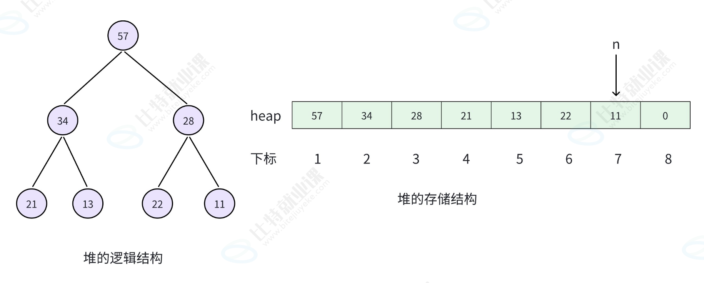

# 堆

<details>
<summary>堆（点击展开）</summary>


## 1. 堆的定义

堆（heap），是一棵有着特殊性质的完全二叉树，可以用来实现优先级队列（priority queue）。

堆需要满足以下性质：
1. 是一棵完全二叉树；
2. 对于树中每个结点，如果存在子树，那么该结点的权值大于等于（或小于等于）子树中所有结点的权值。

如果根结点大于等于子树结点的权值，称为大根堆；反之，称为小根堆。

## 2. 堆的存储

由于堆是一个完全二叉树，因此可以用一个数组来存储。（如果不清楚的同学，可以回顾《二叉树》中的顺序存储部分）

结点下标为 i：
- 如果父存在，父下标为 i/2；
- 如果左孩子存在，左孩子下标为 i × 2；
- 如果右孩子存在，右孩子下标为 i × 2 + 1。



存储固然简单，但是题目不会那么好心，直接给出一个标准的堆。

一般给我们的是一组数，这组数按照给出的顺序还原成二叉树之后，并不是一个堆结构。此时如果想将这组数变成堆的话，有两种操作：

1. 用数组存下来这组数，然后把数组调整成一个堆；
2. 创建一个堆，然后将这组数依次插入到堆中。
3. 核心操作

堆中的所有运算，比如建堆，向堆中插入元素以及删除元素等，都是基于堆中的两个核心操作实现的——向上调整算法以及向下调整算法。

因此，在实现堆之前，先来掌握两种核心操作。

注意：以下所有操作都默认堆是一个大根堆，小根堆的原理反着来即可。

## 3. 算法实现

### 3.1 向上调整算法
（可以用ppt展示）
算法流程：

1. 与父结点的权值作比较，如果比它大，就与父亲交换；
2. 交换完之后，重复 1 操作，直到比父亲小，或者换到根节点的位置。

代码实现：

```
int n; // 标记堆的大小
int heap[N]; // 存堆 - 默认是一大根堆
// 向上调整算法
void up(int child)
{
    int parent = child / 2;
    // 如果父结点存在，并且权值比父结点大
    while(parent >= 1 && heap[child] > heap[parent])
    {
        swap(heap[child], heap[parent]);
        // 交换之后，修改下次调整的父子关系，注意顺序不能颠倒
        child = parent;
        parent = child / 2;
    }
}
```

时间复杂度：
最差情况需要走一个树高，因此时间复杂度为 log N。

### 3.2 向下调整算法
算法流程：

1. 找出左右儿子中权值最大的那个，如果比它小，就与其交换；
2. 交换完之后，重复 1 操作，直到比儿子结点的权值都大，或者换到叶节点的位置。

代码实现：

```
int n; // 标记堆的大小
int heap[N]; // 存堆 - 默认是一大根堆
// 向下调整算法
void down(int parent)
{
    int child = parent * 2;
    while(child <= n) // 如果还有孩子
    {
        // 找出两个孩子谁是最大的
        if(child + 1 <= n && heap[child + 1] > heap[child]) child++;
        // 最大的孩子都比我小，说明是一个合法的堆
        if(heap[child] <= heap[parent]) return;
        swap(heap[child], heap[parent]);
        // 交换之后，修改下次调整的父子关系，注意顺序不能颠倒
        parent = child;
        child = parent * 2;
    }
}
```

时间复杂度：
最差情况需要走一个树高，因此时间复杂度为 log N。

## 4. 堆的模拟实现

掌握好向上调整算法以及向下调整算法，堆的实现就变得巨简单了。

### 4.1 创建

- 创建一个足够大的数组充当堆；
- 创建一个变量 n，用来标记堆中元素的个数。

```
const int N = 1e6 + 10;
int n;
int heap[N]; // 存堆 - 默认是一大根堆
```

### 4.2 插入
把新来的元素放在最后一个位置，然后从最后一个位置开始执行一次向上调整算法即可。

```
// 向上调整算法
void up(int child)
{
    int parent = child / 2;
    // 如果比父结点大
    while(parent >= 1 && heap[child] > heap[parent])
    {
        swap(heap[child], heap[parent]);
        child = parent;
        parent = child / 2;
    }
}
// 插入
void push(int x)
{
    // 把该元素放在最后
    heap[++n] = x;
    // 执行一次向上调整算法
    up(n);
}
```

时间复杂度：
时间开销在向上调整算法上，时间复杂度为 O(log N)。

### 4.3 删除栈顶元素

1. 将栈顶元素和最后一个元素交换，然后 n--，删除最后一个元素；
2. 从根节点开始执行一次向下调整算法即可。

```
// 向下调整算法
void down(int parent)
{
    int child = parent * 2;
    while(child <= n) // 如果还有孩子
    {
        // 找出两个孩子谁是最大的
        if(child + 1 <= n && heap[child + 1] > heap[child]) child++;
        // 最大的孩子都比我小，说明是一个合法的堆
        if(heap[child] <= heap[parent]) return;
        swap(heap[child], heap[parent]);
        parent = child;
        child = parent * 2;
    }
}
// 删除
void pop()
{
    // 把第一个元素与最后一个元素交换
    swap(heap[1], heap[n]);
    n--;
    // 执行一次向下调整算法
    down(1);
}
```

### 4.4 堆顶元素

- 下标为 1 位置的元素，就是堆顶元素。

```
// 堆顶元素
int top()
{
    return heap[1];
}
```

时间复杂度：
显然是 (O(1))。

### 4.5 堆的大小

- n 的值。

```
// 堆的大小
int size()
{
    return n;
}
```

时间复杂度：
显然是 (O(1))。

### 4.6 所有测试代码

```
#include <iostream>
using namespace std;
const int N = 1e6 + 10;
int n;
int heap[N];

// 向上调整算法
void up(int child)
{
    int parent = child / 2;
    // 当父结点存在，并且大于父结点的权值时
    while(parent >= 1 && heap[child] > heap[parent])
    {
        swap(heap[child], heap[parent]);
        child = parent;
        parent = child / 2;
    }
}

// 向下调整算法
void down(int parent)
{
    int child = parent * 2;
    // 如果存在孩子
    while(child <= n)
    {
        // 找出最大的孩子
        if(child + 1 <= n && heap[child + 1] > heap[child]) child++;
        if(heap[parent] >= heap[child]) return;
        swap(heap[parent], heap[child]);
        parent = child;
        child = parent * 2;
    }
}

// 插入元素
void push(int x)
{
    heap[++n] = x;
    up(n);
}

// 删除堆顶元素
void pop()
{
    swap(heap[1], heap[n]);
    n--;
    down(1);
}

// 查询堆顶元素
int top()
{
    return heap[1];
}

// 堆的大小
int size()
{
    return n;
}

int main()
{
    // 测试堆
    int a[10] = {1, 41, 23, 10, 11, 2, -1, 99, 14, 0};
    // 将这 10 个数依次放入堆中
    for(int i = 0; i < 10; i++)
    {
        push(a[i]);
    }

    while(size())
    {
        cout << top() << " ";
        pop();
    }
    return 0;
}
```

</details>


